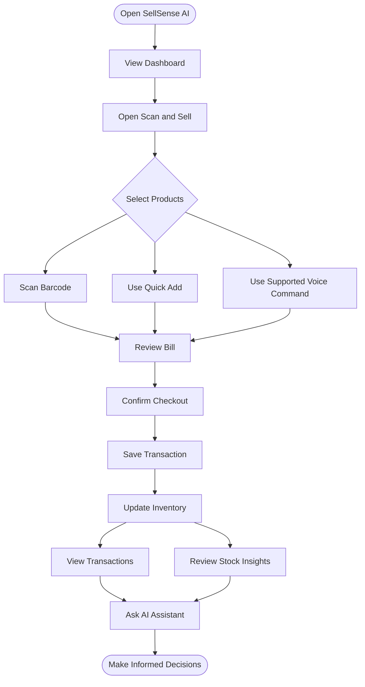
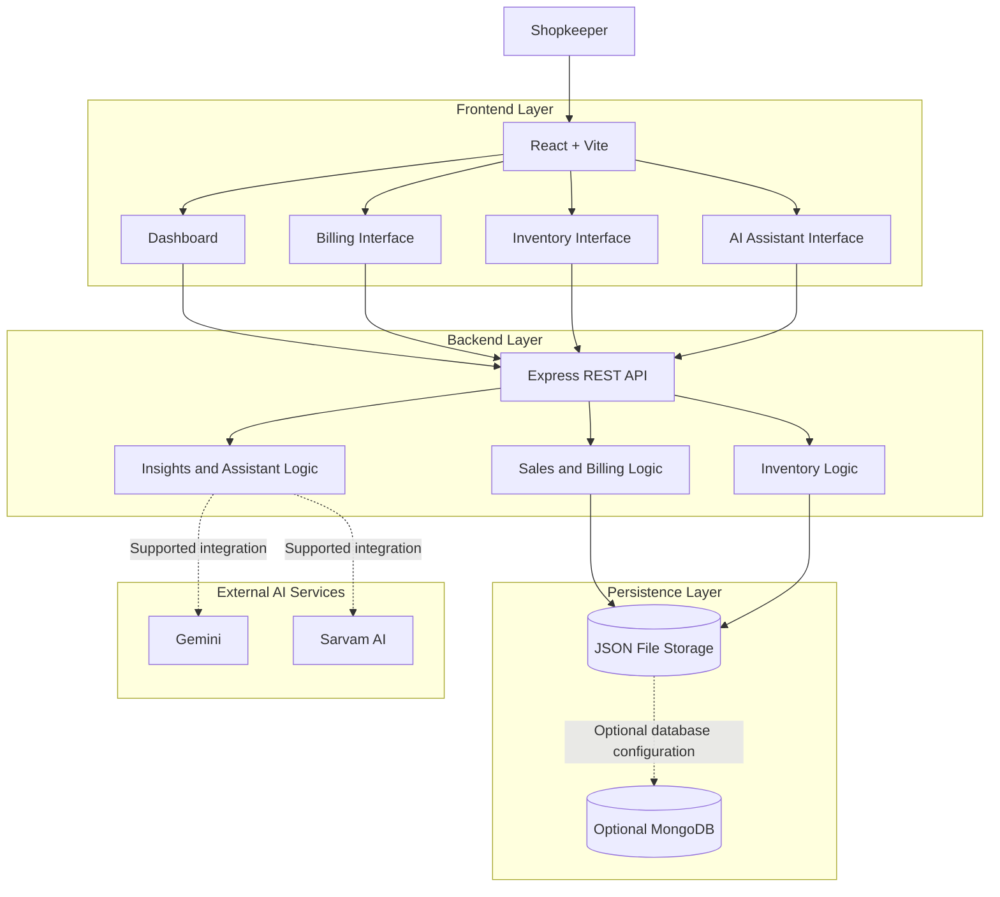

<div align="center">

# ⚡ SellSense AI

### Your Shop. Your Data. Your AI Assistant.

**An AI-powered shop management assistant built for smarter billing, inventory tracking, and sales insights.**

Built for the **Paytm Build for India AI Hackathon**

<br>


**BILL SMARTER · TRACK STOCK · ASK YOUR SHOP**

</div>

---

## 📌 Table of Contents

- [Overview](#-overview)
- [Problem Statement](#-problem-statement)
- [Our Solution](#-our-solution)
- [Key Features](#-key-features)
- [How It Works](#-how-it-works)
- [System Architecture](#-system-architecture)
- [Technology Stack](#-technology-stack)
- [Project Structure](#-project-structure)
- [Installation](#-installation)
- [Environment Configuration](#-environment-configuration)
- [Demo Workflow](#-demo-workflow)
- [Security and Data Handling](#-security-and-data-handling)
- [Limitations](#-limitations)
- [Future Improvements](#-future-improvements)
- [Contributing](#-contributing)
- [License](#-license)
- [Acknowledgments](#-acknowledgments)

---

## 🚀 Overview

**SellSense AI** is a shop management assistant designed to help small retailers manage everyday store operations through a connected digital workspace.

It brings billing, inventory management, transaction records, and conversational assistance into one application.

Instead of navigating multiple screens for every task, shopkeepers can use the available interface, barcode scanning, and supported voice commands to interact with their store.

### At a Glance

| Attribute | Details |
|---|---|
| Project Name | SellSense AI |
| Category | AI for Retail |
| Target Users | Small retailers and neighborhood shops |
| Frontend | React 18 + Vite 6 |
| Backend | Node.js + Express 4 |
| Data Storage | JSON persistence, with optional MongoDB |
| AI Integrations | Gemini and Sarvam AI for supported workflows |
| Project Type | Hackathon prototype |

---

## 🎯 Problem Statement

Small retailers often manage several tasks at the same time:

- Preparing customer bills
- Maintaining product and stock records
- Tracking sales and transactions
- Identifying products that may need restocking
- Understanding daily business activity

Manual processes can make these tasks harder to manage efficiently.

**The challenge:** How can we make everyday shop management simpler and more accessible without requiring shopkeepers to learn complicated software?

---

## 💡 Our Solution

SellSense AI connects important shop operations through a simple interface and a conversational assistant.

| Challenge | SellSense AI Approach |
|---|---|
| Slow product selection | Barcode scanning and Quick Add |
| Repetitive billing tasks | Supported voice commands |
| Difficulty tracking stock | Centralized inventory records |
| Scattered sales information | Transaction history and dashboard |
| Difficulty interpreting store data | Conversational questions and recorded-data insights |

> **Our vision:** Make useful retail technology as easy to use as having a conversation.

---

## ✨ Key Features

<table>
<tr>
<td width="50%">

### 🧾 Smart Billing

- Barcode-assisted product selection
- Quick Add for known products
- Bill and quantity review
- Checkout workflow

</td>
<td width="50%">

### 📦 Inventory Management

- Product and price records
- Stock quantity tracking
- Inventory updates through checkout
- Stock-related insights

</td>
</tr>
<tr>
<td width="50%">

### 🎙️ Conversational Assistant

- Text-based questions
- Supported voice commands
- Store-aware responses
- Language selection

</td>
<td width="50%">

### 📊 Sales Insights

- Dashboard metrics
- Recorded transaction history
- Sales-related questions
- Estimated restocking guidance

</td>
</tr>
</table>

---

## 🔄 How It Works

The following diagram shows the main product workflow.



### Example Interaction

**Shopkeeper:**

> Add two milk packets and one bread to the bill.

**SellSense AI:**

1. Processes the supported command.
2. Matches the requested products against available product records.
3. Adds recognized products to the bill when the required conditions are met.
4. Lets the shopkeeper review the bill before checkout.

After checkout, the sale is recorded and inventory is updated through the application workflow.

---

## 🏗️ System Architecture

SellSense AI follows a client-server architecture.



### Request Flow

1. The user performs an action in the frontend.
2. The frontend sends the required request to the backend.
3. The backend processes the request and accesses the relevant store records.
4. The application returns the result to the frontend.
5. Supported assistant workflows can use configured AI providers.
6. The result is displayed and may be spoken using supported browser features.

**Security principle:** API keys for external AI providers must remain on the server.

---

## 🛠️ Technology Stack

| Technology | Layer | Purpose |
|---|---|---|
| React 18 | Frontend | Builds the user interface |
| Vite 6 | Frontend tooling | Development server and build tooling |
| JavaScript | Application | Implements application behavior |
| Node.js | Backend runtime | Runs server-side code |
| Express 4 | Backend framework | Handles API routes and requests |
| JSON files | Persistence | Provides default local record storage |
| MongoDB | Optional database | Supports configured database persistence |
| Mongoose | Database integration | Supports MongoDB data modeling |
| ZXing Browser | Barcode scanning | Decodes supported barcodes |
| Web Speech API | Browser features | Supports speech recognition and text-to-speech where available |
| Gemini | AI integration | Supports configured AI workflows |
| Sarvam AI | AI integration | Supports configured backend workflows |
| Lucide React | UI | Provides interface icons |

---

## 📂 Project Structure

```text
SellSense_AI_Full_Project/
│
├── client/
│   ├── src/
│   │   └── UI and client-side workflows
│   └── package.json
│
├── server/
│   ├── .env.example
│   └── package.json
│
├── package.json
└── README.md
```

> This is a high-level structure. The exact files and subfolders may differ in your repository. Keep this section aligned with your actual project files.

---

## ⚙️ Installation

### Prerequisites

Install the following before running the project:

- Node.js
- npm
- Git
- Optional: MongoDB
- Optional: AI provider API keys

### Step 1: Clone the Repository

```bash
git clone YOUR_REPOSITORY_URL
```

Replace `YOUR_REPOSITORY_URL` with your actual GitHub repository URL.

### Step 2: Open the Project Directory

```bash
cd SellSense_AI_Full_Project
```

Use the actual directory name if yours is different.

### Step 3: Install Dependencies

```bash
npm install
npm run install:all
```

### Step 4: Configure Environment Variables

Follow the steps in the next section.

### Step 5: Start the Application

```bash
npm run dev
```

The documented development setup uses:

| Service | Default Port |
|---|---:|
| Frontend | `5173` |
| Backend API | `5000` |

Actual ports may vary with your configuration.

### Run Frontend and Backend Separately

**Terminal 1 — Backend**

```bash
npm run dev --prefix server
```

**Terminal 2 — Frontend**

```bash
npm run dev --prefix client
```

Use the scripts available in your actual `package.json` files if they differ.

---

## 🔐 Environment Configuration

Create a `.env` file in the server directory using the provided template.

```bash
cd server
```

Copy `.env.example` to `.env` and configure the values needed for your setup.

### Common Environment Variables

| Variable | Purpose |
|---|---|
| `GEMINI_API_KEY` | Enables supported Gemini workflows |
| `SARVAM_API_KEY` | Enables supported Sarvam AI workflows |
| `MONGODB_URI` | Configures MongoDB connection |
| `CLIENT_ORIGIN` | Configures the allowed frontend origin |

Use the actual `server/.env.example` file as the source of truth for variable names and defaults.

**Never commit real API keys or secret values to GitHub.**

---

## 🧪 Demo Workflow

Use this sequence to demonstrate the main application features.

| Step | Action | Expected Result |
|---|---|---|
| 1 | Open the dashboard | Review store metrics |
| 2 | Open Scan & Sell | Show product selection |
| 3 | Scan a product or use Quick Add | Add a product to the bill |
| 4 | Use a supported voice command | Demonstrate conversational interaction |
| 5 | Review and complete checkout | Record the sale |
| 6 | Open Transactions | Review the recorded transaction |
| 7 | Open Inventory | Check the resulting stock quantity |
| 8 | Ask about restocking | Demonstrate available store insights |

### Demo Preparation Checklist

- [ ] Reset sample data before the presentation.
- [ ] Test the exact voice commands you intend to demonstrate.
- [ ] Confirm the products used in the demo exist in inventory.
- [ ] Check camera permissions if using barcode scanning.
- [ ] Keep Quick Add or manual selection available as a fallback.
- [ ] Test any AI provider integration before the presentation.

---

## Deploying to Vercel

This repository uses Vercel Services with the repository root as the Vercel project root. The `client` service serves the frontend, while the `server` service handles requests under `/api/`.

- Leave `VITE_API_URL` unset for this single-domain deployment. The frontend will use the same-origin `/api` route. If configured explicitly, use `/api`—do not leave a placeholder such as `your_deployed_backend_url`.
- Add `GEMINI_API_KEY`, `SARVAM_API_KEY`, and `MONGODB_URI` as server-side environment variables only when those integrations are used. Never expose provider credentials through `VITE_*` variables.
- Set a hosted MongoDB connection for persistent production data. Without it, the Vercel JSON fallback uses `/tmp` only to support a demo; its contents are ephemeral and can disappear or differ across serverless instances.
- Set the Vercel project Root Directory to the repository root so Vercel can read the multi-service `vercel.json`.

## 🔒 Security and Data Handling

SellSense AI follows a client-server approach to application data and external provider credentials.

- Keep provider API keys on the backend.
- Store secrets in environment variables.
- Do not commit `.env` files.
- Validate incoming requests on the server.
- Configure allowed frontend origins appropriately.
- Use sample data for public demonstrations.
- Avoid putting real customer or payment-sensitive information into a demo environment.

---

## ⚠️ Limitations

To keep expectations clear, the current prototype has the following boundaries:

| Area | Limitation |
|---|---|
| Payment verification | A merchant-entered status does not prove that a bank or payment provider confirmed the payment. |
| Revenue insights | Calculations depend on recorded transaction status and available data. |
| Profit calculations | True profit requires purchase costs and relevant expenses, which are not fully recorded by the current workflow. |
| Restocking estimates | Estimates depend on current stock and recorded sales; they are not guarantees. |
| AI features | AI workflows require connectivity and valid provider configuration. |
| Speech features | Browser and device support may vary. |
| Offline use | Supported local operations may work without AI, but the entire application is not guaranteed to work offline. |

---

## 🚀 Future Improvements

Potential improvements for future versions:

- [ ] Automated tests for billing and inventory workflows
- [ ] Low-stock alerts and configurable reorder thresholds
- [ ] Improved transaction audit history
- [ ] Role-based access for shop owners and staff
- [ ] More extensive language and accessibility testing
- [x] Deployment documentation
- [ ] Production monitoring and error reporting

These items are proposed enhancements, not claims about existing features.

---

## 🤝 Contributing

Contributions and feedback are welcome.

1. Fork the repository.
2. Create a new feature branch.
3. Make focused changes.
4. Test the relevant workflows.
5. Update the documentation where needed.
6. Open a pull request with a clear summary.

---

## 📄 License

No license has been specified here.

If you intend to distribute this project as open source, add an appropriate `LICENSE` file and update this section.

---

## 🙌 Acknowledgments

Built as an independent project for the **Paytm Build for India AI Hackathon**.

SellSense AI is an independent hackathon prototype and is not presented as an official Paytm product.

---

<div align="center">

### ⚡ SellSense AI

**Simplifying everyday retail with connected workflows and conversational AI.**

*Built for smarter shop management.*

</div>
